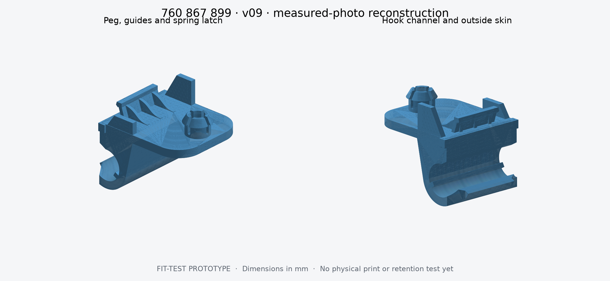
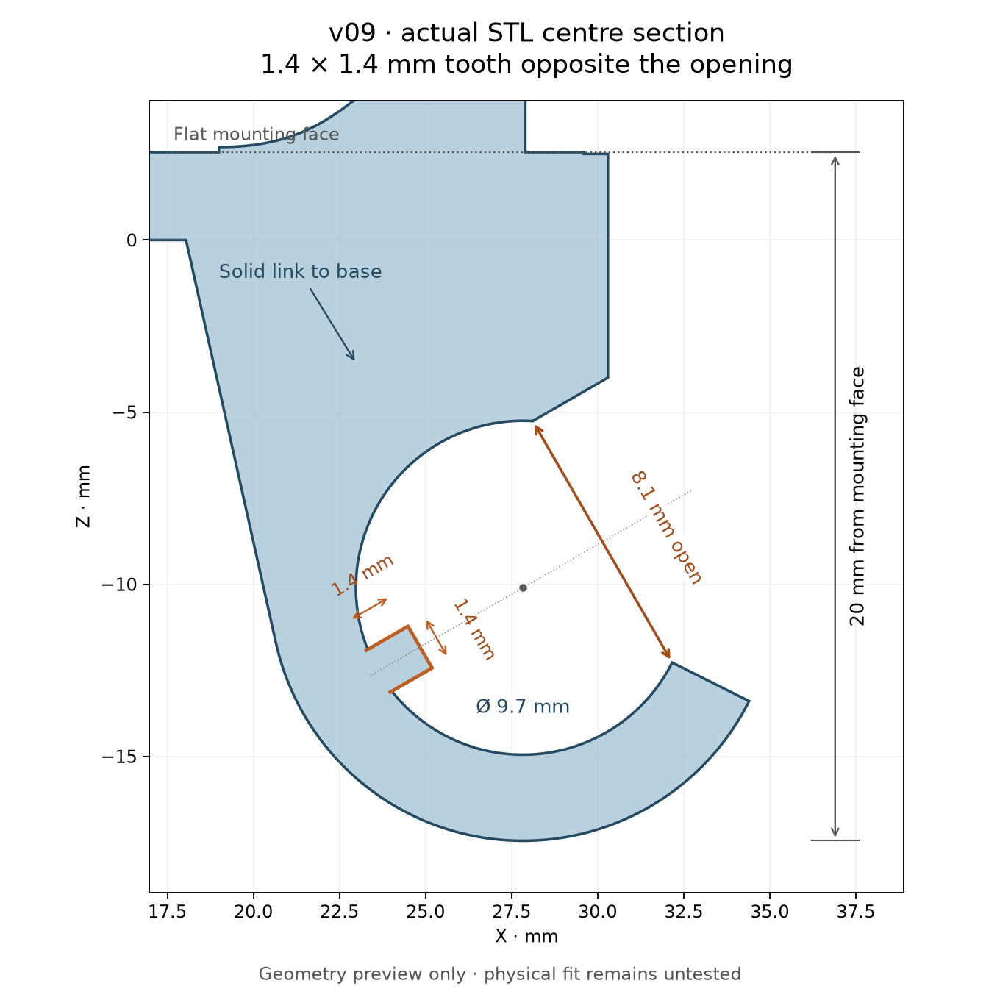
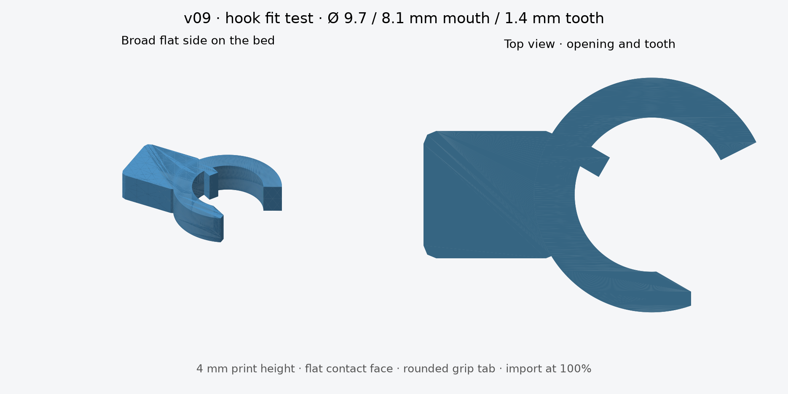
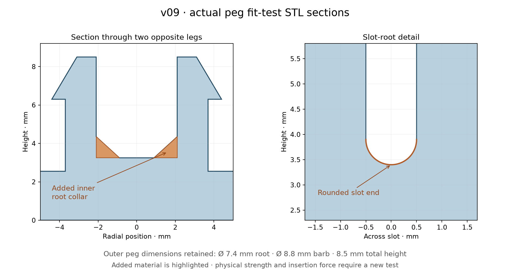

# VW Touareg tailgate clip — 760 867 899

Printable reconstruction from photographs and caliper measurements of the original clip.

**Status: v09 prototype with flush/tangent hook backing and reinforced peg roots. This revision has not been printed or fit-tested.**









## STL files

All files use millimetres. Import at 100% scale.

- [`stl/760867899_clip.stl`](stl/760867899_clip.stl): complete clip in design coordinates.
- [`stl/760867899_clip_on_side.stl`](stl/760867899_clip_on_side.stl): the same clip rotated onto one side, with its lowest surface at Z=0. Inspect supports before printing.
- [`stl/760867899_hook_fit_test.stl`](stl/760867899_hook_fit_test.stl): a compact **side-printable hook gauge** with a rounded grip tab. It has the actual 9.7 mm bore, 8.1 mm mouth and 1.4 × 1.4 mm tooth, without the bulky mounting body. It is already laid on its broad flat side and is only **4 mm high**. Import at 100%, keep this orientation and print without supports. It checks the mating shape, not full-width stiffness or retention.
- [`stl/760867899_peg_fit_test.stl`](stl/760867899_peg_fit_test.stl): the reinforced split peg on a 14 × 14 mm flat base. Print this updated test with the peg upright to check the new root support and fitting force before printing the complete clip.

The complete part has undercuts and a horizontal peg in the side orientation.
It has not been sliced or printed. Keep support material out of the four peg
slots and the spring latch where possible; inspect and clear those gaps before
attempting a fit. Do not force an undersized hook or oversized peg into the car.

## Validation and rebuilding

The exported STLs were reloaded and checked for a single connected solid,
watertightness, consistent winding, positive volume and no degenerate triangles.
See [`validation/geometry_checks.json`](validation/geometry_checks.json).
Cross-sections of the exported clip also independently verify the hook openings,
peg diameters and height, both fins, the 9 mm longitudinal edge gap, lip width
and latch width to 0.003 mm of the
design values. That is a digital geometry tolerance, not a physical measurement
or printing accuracy claim.
The checks also measure the 20 mm hook drop and the 1.4 × 1.4 mm projecting tooth
at both ends and the centre. Fifty-one rays through the exported STL's entry
path check that the mouth is not blocked by the platform, frame or neck.
Twenty additional sections across the back link verify one continuous material
interval at the former gap, including the centre and both sides.
The hook gauge has separate exported-STL checks: full first-layer contact, a
constant profile through its 4 mm print height, matching mating geometry against
the complete clip, and measured bore, mouth and tooth at three width stations.
The external grip tab does not intrude into the cavity or entry. Its footprint
is approximately 20.92 × 14.75 mm.
Additional exported sections check the flush side width, tangent backing and
lower circular exterior, eight diagonal sections of the peg collar, and ten
points along its rounded slot ends. These are geometry checks, not evidence of
physical strength, printed fit or service life.

The rebuildable source is provided to preserve the design history even though
only STLs are needed for printing:

```sh
python3 -m venv .venv
.venv/bin/pip install -r model/requirements.txt
.venv/bin/python model/build.py
```

[`model/parameters.json`](model/parameters.json) separates measured dimensions
from estimates. v09 retains the separately measured left and right fins and
places their nearest vertical edges **9 mm beyond the hook-facing edge of the
peg root along the length of the base**. This is an approximate physical
measurement implemented as 9.0 mm in the model.

The back of the hook now joins the mounting base through a **solid full-width
web**, filling the triangular gap left in v05. The original rear slope is kept;
only the hook cavity and entry remain open. This is a geometry change requested
by the owner, rather than a reproduction of the OEM material-saving recess.

The separate lateral support webs have been removed. The hook, back link and
neck now stay within the **26.3 mm base width**, with no support projecting
past the base below the mounting plane. The solid back link meets the outer
hook circle at a tangent, eliminating the stepped middle/lower support corners.
The independently measured **27.6 mm front crossbar** remains local to the frame;
it is distinct from the removed side-support ledges.

The peg now includes an **internal tapered root collar**. At the cavity floor
(Z=3.25 mm), the inner radius is reduced from 2.1 to 0.9 mm; it tapers back to
2.1 mm over 1.1 mm of height. This adds material inside each leg at its root
while retaining the upper hollow section. The 1 mm-wide slots now terminate in
0.5 mm-radius semicircles, with their lowest cut at Z=3.4 mm instead of the old
sharp Z=3.25 mm corners. Outer diameters and total peg height are retained.
These are new design choices intended to reinforce the roots; insertion force,
flexibility, strength and fatigue must be checked with a fresh physical trial.

The opposite 15 mm-wide latch now joins the base through a continuous wall,
reinforced by three solid gussets on the peg side. Its wall thickness and lean
are photo estimates. The mounting surface beneath peg and fins is flat and
continuous, as requested by the owner; material-saving recesses are omitted.

Looking from the **rounded peg end toward the hook**, with the peg pointing up,
the **right fin is the taller fin** (negative Y). Both fins have a vertical edge
at the peg end and taper toward the hook. Please compare this orientation with
the original before printing the whole part.

## Reference measurements

| Feature | mm | Evidence |
|---|---:|---|
| Overall length | 34.4 | `reference/measurements/01.jpg` |
| Body width at first measurement position | 26.3 | `reference/measurements/02.jpg` |
| Earlier caliper span; not used as total height | 19.8 | `reference/measurements/03.jpg`; superseded height interpretation |
| Hook inside diameter | 9.7 | Owner correction explicitly confirmed as diameter; supersedes the initial 9.4 mm reading in photo 08 |
| Hook mouth, narrower entrance | about 8–8.2; model 8.1 | `reference/measurements/09.jpg` and owner clarification |
| Mounting face down to farthest outside hook edge, perpendicular | 20 | Owner measurement and explicit direction clarification |
| Internal tooth local height / inward projection | 1.4 / 1.4 | Owner corrected the earlier 2.4 mm values and specified placement opposite the opening |
| Narrow hook lip width | 17.3 | `reference/measurements/10.jpg`; read from jaw placement |
| Maximum frame width | 27.6 | `reference/measurements/11.jpg` |
| Outside guide width | 26.0 | `reference/measurements/12.jpg` and owner clarification |
| Base wall | 2.5–2.6 | Owner measurement; design uses midpoint 2.55 |
| Peg total height, including base wall | 8.5 | Owner measurement |
| Peg widest diameter / base diameter | 8.8 / 7.4 | Owner measurement |
| Spring latch width | 15.0 | Owner measurement |
| Right fin: base / top length | 9.9 / 5.5 | Owner measurement |
| Right fin: height above inner surface | 7.6 | Owner measurement and explicit height clarification |
| Left fin: base / top length | 9.5 / 6.9 | Owner measurement |
| Left fin: height above inner surface | 3.7 | Owner measurement |
| Both fin walls | 1.6 | Owner measurement |
| Peg root to nearest fin edges, along base length | about 9 | Owner measurement; edge-to-edge direction explicitly confirmed |

The peg position, hollow centre and slits, latch positions, flexure thicknesses,
and small radii are photo estimates. Photographs do not provide a calibrated 3D scan.

The mounting face is Z=2.55 mm. The corrected hook drop puts its lowest outside
edge at Z=-17.45 mm. The right fin reaches Z=10.15 mm, making the complete model
**34.4 × 27.6 × 27.6 mm**. v01–v03 incorrectly treated the earlier 19.8 mm caliper
span as the entire part height; v04 supersedes that interpretation.

The mouth points diagonally outward, as shown in the new side photo, rather
than upward into the mounting platform. Its direction is estimated at 30°
above the base's length axis. The 9.7 mm circular cavity and an 8.1 mm-wide
entry corridor are cleared from the plate/frame/neck geometry; the C-shaped
hook supplies the mating surface. The upper fixed arm stays attached to the
mounting platform, while the entry remains open.

The internal feature is a solid transverse **rib**, not a recessed groove.
It projects 1.4 mm radially inward from the nominal inner wall and measures
1.4 mm along the local tangent of the bore. Its centreline is diametrically
opposite the mouth centreline, as specified by the owner, and it runs across
the part width. The section preview shows the shared diameter as a dotted line.
Its small edge radii remain estimates. The hook's
approximately 2.5 mm shell thickness is also estimated; the measured 2.5–2.6 mm
wall value belongs to the mounting base.

The peg centre remains an estimate at X=5.4 mm from the rounded end. Its root
ends at X=9.1 mm; the fins start at X=18.1 mm. The flat platform extends to
X=29.6 mm to support the fins and latch, while overall length stays 34.4 mm.
Only the relative peg-to-fin station has now been measured. The latch station,
its approximately 1.2 mm-thick support wall and the front frame position remain
photo estimates and should be compared with the original before printing.

## First print

1. Print the hook and peg fit-test pieces at 100% scale. The peg piece sits flat
   with the peg upright. Keep the hook gauge on its broad flat side as supplied:
   it is 4 mm high with approximately 130 mm² of bed contact. No supports are
   needed for its constant profile. Use the rounded external tab to hold it.
   The complete clip still requires separate inspection of support placement.
2. Compare the full clip preview with the original, especially the tall-fin side.
3. Inspect support placement and layer paths for the full clip. The side STL is
   an orientation option, not a validated print profile. Its small contact area
   may need a brim, and its horizontal peg and fins may need support.
4. Check fit gently, then inspect for cracking and adequate retention before
   using it to hold tailgate trim. A fit-test pass does not establish service life.

Printer, material, shrinkage, temperature resistance and spring fatigue have not
been validated. No material-specific printer settings are supplied.

## Revision policy

Commit every model revision with its STL files, source parameters, preview, checks,
and change notes. Keep stable filenames for the current files; Git history retains
all prior revisions. Do not squash or overwrite the design history.

## Photographs

- `reference/measurements/`: nineteen owner-provided JPEG references, in received
  order, published with the owner's explicit permission. Camera metadata was
  removed before inclusion. Photos 13 and 14 show the same measurement view;
  photos 15–18 show the latch wall and its reinforcement in close-up; photo 19
  shows the hook's open side profile and projecting internal rib.
- `reference/listing/source.txt`: the public product listing and original photo
  links, for provenance only. The seller's photographs are **not redistributed**
  in this repository, including in its published Git history.

VW and Touareg identify the part reference only. This project is not an OEM CAD
release or a certified replacement.
