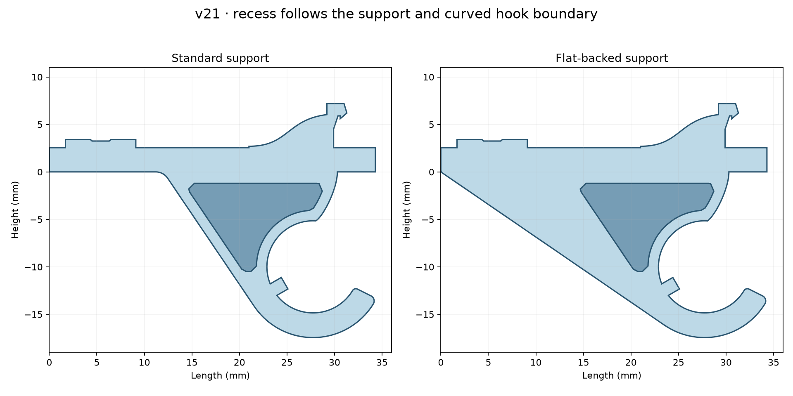
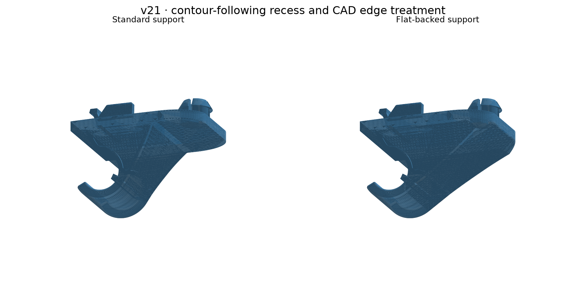

# v21 — flat-backed support, contour recess and CAD fillets

[Download the flat-backed STL](stl/760867899_v21_flat_support.stl).

The side recess now follows the support outline and curved hook boundary, with an approximately 1.1 mm border and 0.6 mm depth. The flat back remains a continuous printing face. The measured upper mounting features are retained from v19.

This replaces the previous mesh-smoothed free-tip edge with a native CAD R0.4 fillet on both sides. The flat-back variant also has an additional R0.4 edge fillet and R0.1 shoulder fillets. **Some long support edges and the recess rim remain sharp: the CAD kernel rejected those fillets. This is an improved interim finish, not a completed fillet of every exposed edge.** The recess outline has rounded corners, represented by short contour segments.

Validation: valid native CAD body; exported STL is watertight, consistently wound and a single connected positive-volume mesh. Central hook bore measures 9.698 mm in the tessellation (9.7 mm CAD diameter). Flat printing contact is 534 mm², with less than 0.001 mm deviation below its plane. Physical fit remains unverified.

Only the flat-backed version will be developed from this revision onward, as requested. The preview includes the standard version generated before that instruction.

## Source

`source/native.py` uses FreeCAD 1.x Python modules and `source/parameters.json` to export the native body. `finish.py` adds the measured v19 mounting features with manifold3d; it was run in the original task layout and records its input/output paths. `check_final.py` records the dimensional and printing-plane checks. Earlier v19 source and fixtures remain in history. Failed fillets are reported explicitly by the native builder rather than silently accepted.
