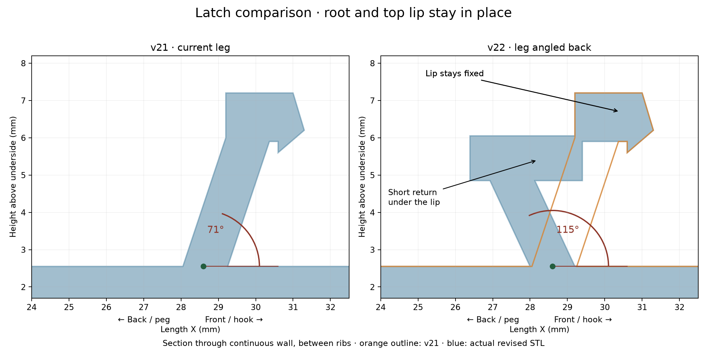

# v22 — backward-leaning retaining latch

The continuous latch wall leans back toward the peg at **115° from the forward base direction**, replacing the former approximately 71° forward lean. The wall root at X=28 mm and the complete top lip profile stay fixed. A 1.2 mm thick horizontal return connects the reversed wall to the unchanged lip. Three reinforcement ribs keep their base starting positions and meet the new wall.

[Flat-backed STL](stl/760867899_v22_flat_support.stl)

The section is extracted from both actual meshes at Y=2.5 mm, between reinforcement ribs. Orange is the v21 outline. The small return is necessary to retain both the original root and lip positions while reversing the wall angle.

Mesh validation: watertight, consistent winding, one connected solid. Boolean checks confirm zero material removed from the protected remainder of v21 and preservation of the top lip. The flat back, hook, peg and fins are retained. Physical fit and spring action require printing. The latch removal starts 0.01 mm above the mounting face to avoid a coplanar mesh seam.

Reproduce with `python drafts/v22/source/revise_latch.py` using numpy, trimesh, manifold3d, scipy and matplotlib. Input is the committed v21 flat-backed STL and its parameters.
