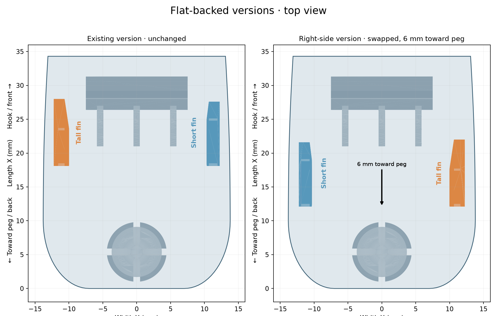

# v23 — right-side fin variant

Two flat-backed STLs are supplied:

- [Right-side version](stl/760867899_v23_right_flat_support.stl): tall and short fins swapped across the width, with both translated exactly 6 mm toward the peg. Their root station is X=12.1 mm instead of X=18.1 mm. Fin heights, profiles, rounded ends, inward lean and 24.5 mm outside root spacing are retained.
- [Existing version](stl/760867899_v23_existing_flat_support.stl): byte-for-byte copy of v22.

Only fins are mirrored and moved; the hook, peg, backward-leaning 115° latch, base and flat printing support stay unchanged. Right-side fit is not yet physically verified.

The new STL is watertight, consistently wound and a single connected solid. A Boolean comparison confirms no material changes outside the two original and relocated fin regions, within numerical tolerance. Fin roots are extracted with 0.01 mm overlap into the original mounting plate, which is restored at their former positions.

Reproduce from the v22 flat-backed STL with `python drafts/v23/source/right_side.py`. Uses numpy, trimesh, manifold3d, scipy and matplotlib.
