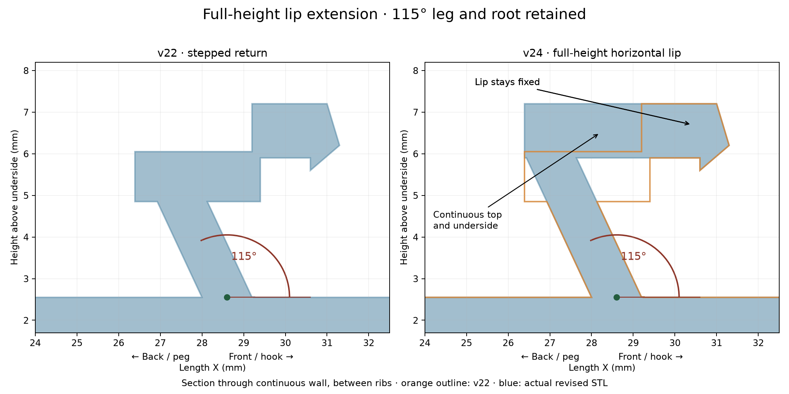

# v24 — continuous horizontal latch cap

The return now extends up to the existing lip top at Z=7.2 mm. Its underside aligns with the lip underside at Z=5.9 mm. The resulting 1.3 mm thick cap has a single horizontal top and underside up to the retaining tooth. The tooth, lip front location, 115° leg and leg root are retained. This replaces the stepped return of v22/v23.

- [Existing fin layout STL](stl/760867899_v24_existing_flat_support.stl)
- [Right-side STL](stl/760867899_v24_right_flat_support.stl): swapped fins, shifted 6 mm toward peg.

Both versions remain flat-backed. Both exports pass watertightness, consistent winding and single-component checks. Physical fit and spring action remain untested.

Reproduce by running source/revise_latch.py followed by source/right_side.py from the repository, using numpy, trimesh, manifold3d, scipy and matplotlib. Input body/parameters are preserved in v21; the preview compares against v22. All changes remain in revision history.
