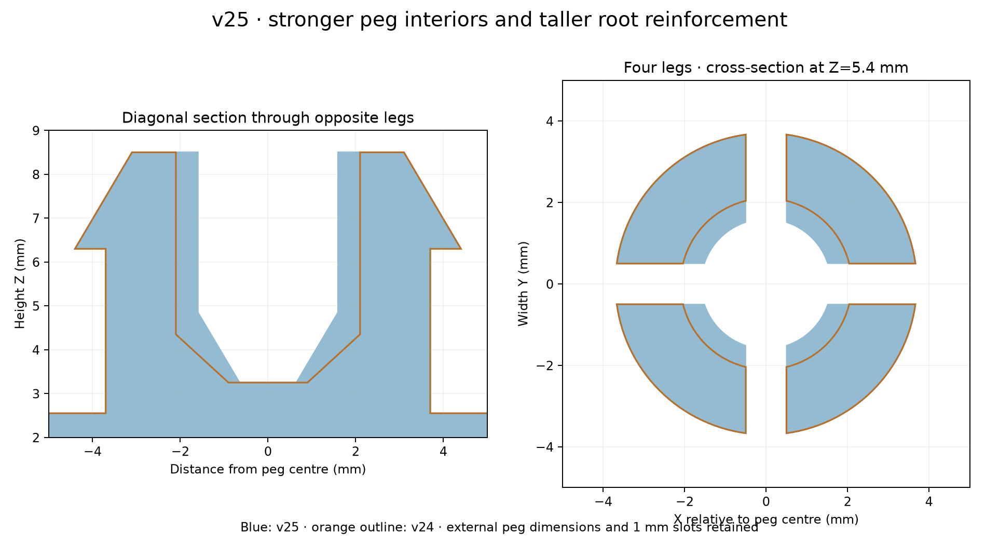

# v25 — thicker peg legs and taller internal root support

- [Existing fin layout STL](stl/760867899_v25_existing_flat_support.stl)
- [Right-side STL](stl/760867899_v25_right_flat_support.stl)

The peg legs gain 0.5 mm of material on their inside faces: main stem radial wall thickness increases from 1.6 to 2.1 mm, and the central opening decreases from 4.2 to 3.2 mm. The internal tapered collar grows from 1.1 to 1.6 mm tall, with its bottom cavity radius reduced from 0.9 to 0.65 mm. The rounded slot roots move up 0.25 mm, shortening the unsupported leg length slightly.

The outside remains 7.4 mm at the root, 8.8 mm across the barbs and 8.5 mm overall height. Existing external 1 mm slots remain; the new internal reinforcement leaves a 1.02 mm gap to avoid coincident mesh seams. This retains the four separate legs and flex slots. Material is added only inside the peg region, approximately 19.94 mm³ per part. Peg and all other exterior geometry remain from v24.

Both meshes reload as watertight, consistently wound, single connected solids. Boolean checks confirm no removed material and no addition outside the peg region within numerical tolerance. Both layouts retain the flat back and continuous horizontal latch cap. Printed strength and insertion force remain untested; thicker legs will be stiffer.

Reproduce with `python drafts/v25/source/reinforce_peg.py`. Inputs are both committed v24 STLs and the stored v21 parameters. Uses numpy, trimesh, manifold3d, scipy and matplotlib.
