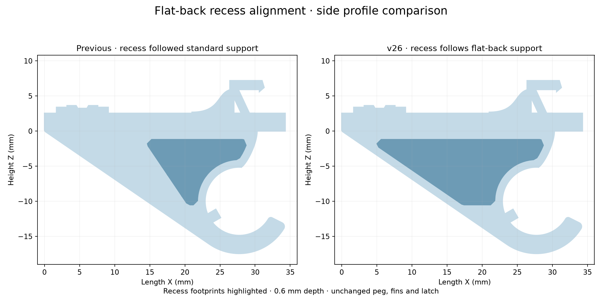

# v26 — recess aligned with the flat-backed support

The recess rear edge now follows the flat-back support slope, approximately 1.1 mm inside it, rather than the steeper standard-support profile. It extends rearward from approximately X=14.7 mm to X=5.0 mm. The curved boundary around the hook remains. Recess depth stays 0.6 mm, with rounded outline corners and a successful native CAD R0.2 floor fillet. The rim remains unfilleted. The lower extent remains Z=-10.5 mm to retain material around the hook root.

- [Existing fin layout STL](stl/760867899_v26_existing_flat_support.stl)
- [Right-side STL](stl/760867899_v26_right_flat_support.stl)

Both retain the reinforced v25 peg, full-height horizontal latch and their respective fin layouts. Both are flat-backed.

Checks: valid native CAD body; both exported parts are watertight, consistently wound and single connected meshes. A Boolean comparison above Z=0.02 mm confirms the mounting plate and fixtures remain unchanged within numerical tolerance. Physical fit remains untested.

Reproduce by running source/prepare.py, then source/native.py with FreeCAD Python, then source/finish.py. The preparation/finish scripts use numpy, trimesh, manifold3d, scipy and matplotlib. Native body exports are intermediate outputs and are regenerated by the included source. FreeCAD library path in native.py refers to the installed macOS application.
