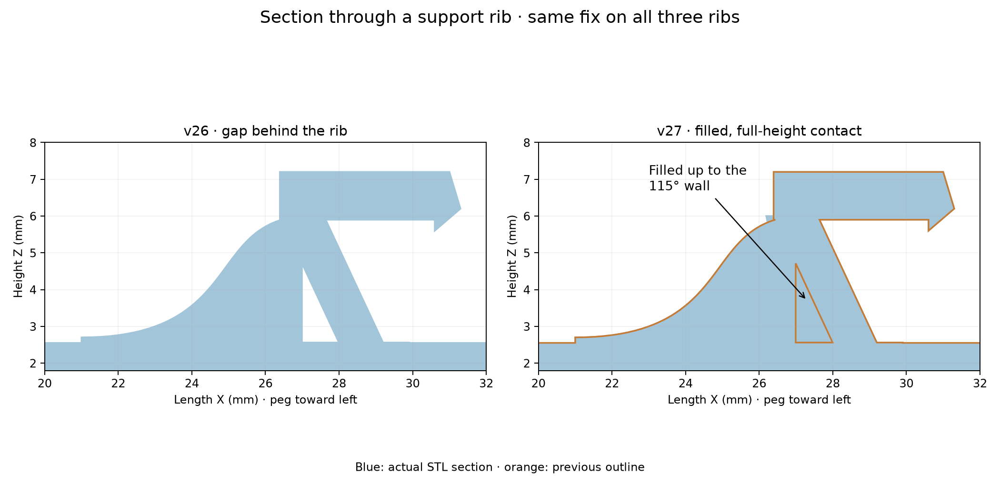

# v27 — fill all three latch-rib gaps

The three curved support ribs now join the peg-facing surface of the 115° latch wall continuously, from the mounting plate up to the horizontal cap. Solid wedges fill the previous triangular openings. Existing rib widths and locations are retained (0.95 mm at Y=-5.4, 0, +5.4 mm), with a 0.2 mm overlap into the wall for reliable joining.

- [Existing fin layout STL](stl/760867899_v27_existing_flat_support.stl)
- [Right-side STL](stl/760867899_v27_right_flat_support.stl)

The cap, 115° leg, peg reinforcement, fin layouts, hook recess and flat back remain from v26. Material is only added at the rib/wall junctions. Checks confirm watertight, consistently wound, single connected output meshes, no removed material within numerical tolerance, and continuous contact at 75 sampled heights on each rib. Physical fit and strength remain untested.

Reproduce with `python drafts/v27/source/fill_latch_ribs.py`, using the v26 STLs and stored dimensions. Requires numpy, manifold3d, trimesh, scipy and matplotlib.
