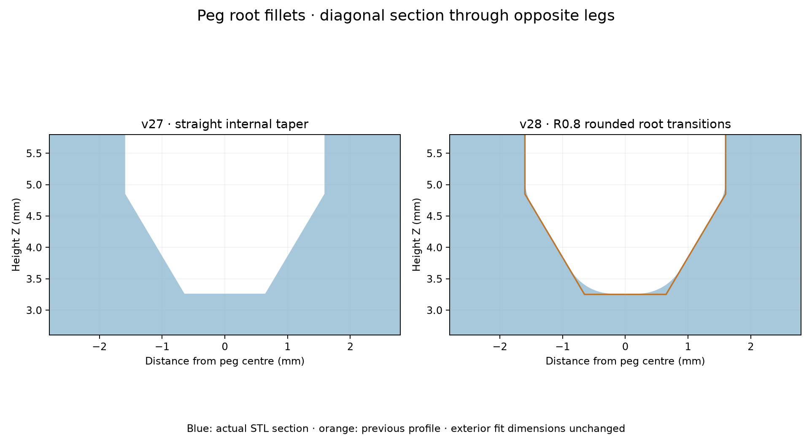

# v28 — rounded internal peg-root transitions

- [Existing fin layout STL](stl/760867899_v28_existing_flat_support.stl)
- [Right-side STL](stl/760867899_v28_right_flat_support.stl)

The internal peg-root taper now has additive circular fillets, nominal R0.8 mm, where it meets the cavity floor and upright inner leg surfaces. The floor transition is visibly rounded rather than a sharp cone/floor corner. This adds material inside the roots and retains the v25 wall reinforcement. The outside root/barb diameters, peg height, external slots and other fixtures remain unchanged within STL precision. Physical strength improvement and insertion force are not yet tested.

The fillet arcs are sampled from circles tangent to the floor, conical taper and upright inner wall. The upper cavity is given 0.01 mm numerical clearance and the additive fillet is unioned with the original geometry, so existing material is retained. The reinforcement leaves 1.04 mm slots internally to avoid coincident seams; existing external slots are unchanged. The resulting upper blend is clipped where the original material already extends beyond it. STL vertices within 0.00001 mm rounding bins are merged to eliminate submicron seams.

Both files reload as watertight, consistently wound, single connected meshes. Boolean checks confirm additive-only changes confined inside the peg region, within numerical tolerance. The flat printing back, aligned recess, filled latch ribs and both fin layouts remain from v27.

Reproduce with `python drafts/v28/source/round_peg_roots.py`, using the v27 STL inputs. Requires numpy, trimesh, manifold3d, scipy and matplotlib.
