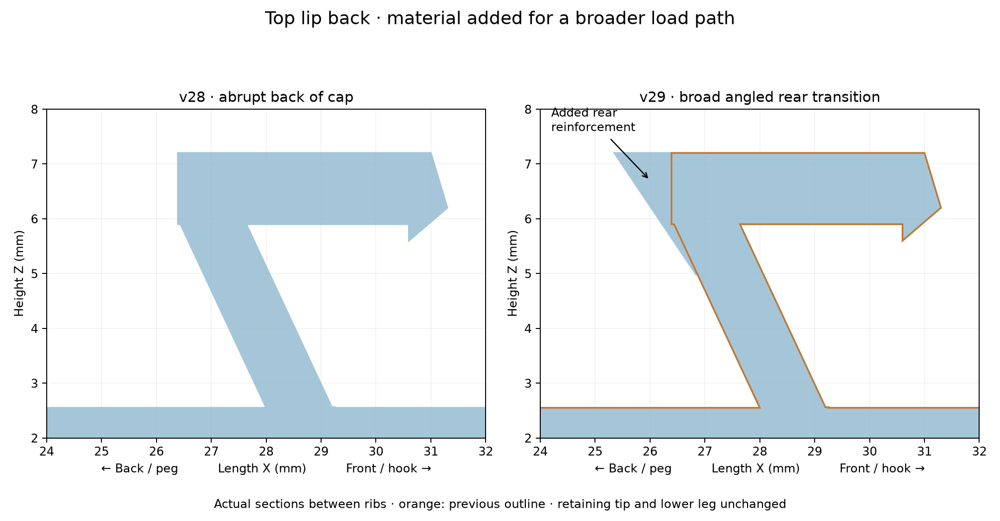

# v29 — reinforced chamfered back of top lip

- [Existing fin layout STL](stl/760867899_v29_existing_flat_support.stl)
- [Right-side STL](stl/760867899_v29_right_flat_support.stl)

The abrupt vertical back of the latch cap is replaced by a broad, angled reinforcement spanning the full 15 mm latch width. The addition starts near Z=4.98 mm on the upper leg and reaches the lip top at Z=7.2 mm. The rear top moves from X=26.391 to X=25.35 mm (1.041 mm farther toward the peg). The front retaining edge, tooth and lower 115° leg remain unchanged. The lip top remains horizontal.

This is an additive chamfer-shaped gusset, intended to broaden the load path rather than thin the existing wall. It preserves the filled ribs, internal peg-root rounding, strengthened peg legs, flat-back recess and both fin layouts from v28. It needs the additional rear clearance noted above. Printed fit and strength, including any claim of maximum strength, remain unverified.

Both STLs reload as watertight, consistently wound, single connected meshes. Boolean checks confirm no removed material and additions confined to the rear cap/upper-leg region, within numerical tolerance.

Reproduce with `python drafts/v29/source/strengthen_lip_back.py`, using the committed v28 STL inputs. Requires numpy, manifold3d, trimesh, scipy and matplotlib.
