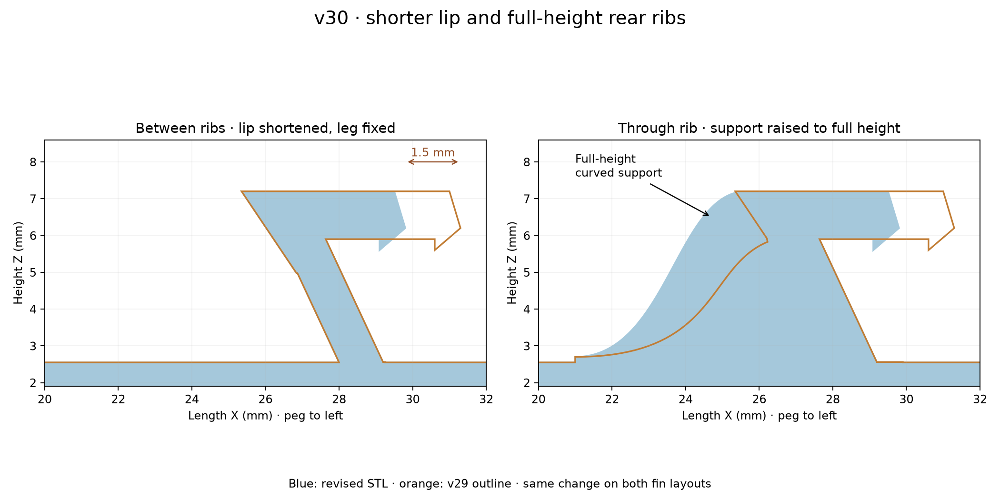

# v30 — 1.5 mm shorter lip and full-height rear supports

- [Existing fin layout STL](stl/760867899_v30_existing_flat_support.stl)
- [Right-side STL](stl/760867899_v30_right_flat_support.stl)

The lip is shortened along X, its forward projection toward the hook, by 1.5 mm. The retaining tooth/front contour shifts from a tip at X=31.3 mm to X=29.8 mm. The lower 115° leg and its root position remain unchanged; the rear chamfer and cap height are preserved. Lip width remains 15 mm.

All three rear supports now have smooth cubic upper profiles that rise to the full cap height Z=7.2 mm, instead of ending around Z=6 mm. Their roots remain at X=21 mm, at the same Y positions and 0.95 mm thickness. Solid support is continuous from base to cap.

Both outputs reload as watertight, consistently wound, single connected meshes. Checks verify no material removed from the lower leg, changes confined to the lip and three support regions, and solid continuity at 80 sampled heights in each support. Other geometry remains from v29; vertices are merged within 0.00001 mm rounding bins for clean STL seams. Physical fit, strength and retention remain untested.

Reproduce with `python drafts/v30/source/shorten_lip_raise_ribs.py` using the committed v29 STL inputs. Requires numpy, manifold3d, trimesh, scipy and matplotlib.
